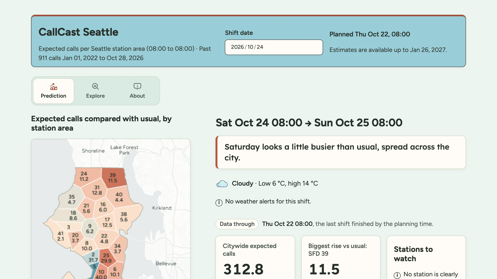

# CallCast Seattle app walkthrough

This walkthrough explains what a new team member sees in the app and, below
each screen, where every number comes from. It also describes the model,
the data, the calculations and the files behind the page.

The app is a supervisor-facing screen, not a staffing system. It predicts
911 call counts for one 08:00-to-08:00 shift. It does not know which units
are free, how long calls take or how far units must travel.

## 1. Start the app

From the repository root:

```bash
uv run streamlit run app.py
```

Open the local address printed by Streamlit. It is usually
`http://localhost:8501`.

The app has three tabs:

1. **Prediction** - choose a date and station, see point estimates and ranges,
   view the map and download the table.
2. **Explore** - compare past weekday, monthly, station and call-category
   patterns.
3. **Data and limits** - read the source, definitions, left-out data and
   limitations.



The main code files are:

* [`app.py`](../app.py) builds the Streamlit page and chart elements.
* [`app_data.py`](../app_data.py) reads CSVs, checks data, computes the usual
  calls and invokes the saved model.
* [`predict.py`](../predict.py) loads the saved GBM and transforms 34 feature
  rows into 34 predictions.
* [`model_metadata.json`](../model_metadata.json) describes the model cutoff
  and raw input columns.
* [`poisson_gbm.joblib`](../models/poisson_gbm.joblib) stores the fitted
  Poisson GBM.

Streamlit reruns `app.py` when a sidebar selection changes. App data is
cached and is reread when the file modification times change.

## 2. The data loaded at startup

The app reads only the files needed for the page:

| File | App value | How the app uses it |
|---|---|---|
| [`sfd_stations.csv`](../data/sfd_stations.csv) | `stations` | station menu, station count, map dots and map coordinates |
| [`station_shift_counts.csv`](../data/station_shift_counts.csv) | `counts` | past calls, outage flags, weekday averages and Explore history |
| [`modeling_dataset.csv`](../data/modeling_dataset.csv) | `features` | model feature rows for historical 2026 dates |
| [`forecast_features.csv`](../data/forecast_features.csv) | appended to `features` | model feature rows for October 29–31, with no actual `calls` |
| [`prediction_ranges.csv`](../data/prediction_ranges.csv) | `bands`, `city_range` | point-estimate uncertainty for station and citywide numbers |
| [`hourly_profile.csv`](../data/hourly_profile.csv) | read inside the hourly expander | share of a station shift expected in each hour |

The app does not read the raw 911 export, call-type map or weather and event
experiment files.

Before displaying anything, `load_tables()` validates:

* required CSV columns,
* duplicate station/date rows,
* every station-date combination in the count table,
* whole-number and nonnegative call counts,
* fire + medical + non_emergency + other = `calls`,
* matching station identifiers,
* citywide outage flags, and
* forecast rows that cover 34 stations on every forecast date.

`load_ranges()` also verifies that station bands cover from zero without
gaps and that each range contains a low of zero or less and a high of zero
or more. If the shared files disagree, the app shows an error instead of
displaying a number that may be wrong.

## 3. How one shift is defined

The model and app use one 24-hour shift:

```text
08:00 on the target date -> 08:00 on the following date
```

October 24 is therefore the shift from Saturday October 24 at 08:00 through
Sunday October 25 at 08:00.

The supervisor does not plan in real time for that exact moment. The app
uses Thursday at 08:00 for a Saturday shift:

| Step | SFD 10 example |
|---|---|
| Target shift | Saturday October 24, 08:00 to Sunday October 25, 08:00 |
| Planning time | Thursday October 22, 08:00 |
| Latest complete shift | Wednesday October 21, 08:00 to Thursday 08:00 |
| Earliest discarded planning data | Thursday and Friday counts that did not exist at planning time |

`forecast_origin()` computes the planning time as two calendar days before
the target shift, localized to `America/Los_Angeles`.

`known_history()` keeps only counts for shifts that had finished at that
planning time:

```python
latest_complete = target_date - 3 days
history = counts.loc[
    (counts["ShiftDate"] <= latest_complete)
    & ~counts["Masked"]
]
```

The three-day subtraction is not an arbitrary safety rule. The model uses
features starting at `lag3`, and lags 1 and 2 would contain shifts not
finished at the Thursday morning planning time.

The date picker starts at January 3, 2026. It ends at the latest forecast
date, currently October 31, 2026.

Thirteen historical shifts have missing model-input rows:
January 9; March 20; April 23; May 7; June 13; July 17, 19, 20, 22, 24 and
25; August 20; and September 17. For one of those dates, the app displays:

```text
No estimate for this date: the call data for this shift has a gap.
```

The app still knows station locations and may show history where available.

## 4. The normal Saturday example


Leave the date at October 24 and the station at SFD 10. The page calculates:

| Card or column | Value | Meaning |
|---|---:|---|
| Citywide expected calls | 313.6 | Sum of 34 station point estimates |
| SFD 10 expected calls | 39.3 | Fitted GBM estimate for SFD 10 |
| SFD 10 Usual | 38.9 | Earlier Saturday average for SFD 10 |
| SFD 10 Difference | +0.3 | 39.3 minus 38.9 |
| Citywide Usual | 306.4 | Sum of all 34 station weekday averages |
| Citywide Difference | +7.1 | 313.6 minus 306.4 |

The card values use rounded display numbers. The citywide difference is
calculated from the full, unrounded station sums, even though it is shown
to one decimal.

## 5. How the usual number is calculated

`reference_predictions()` does not ask the GBM for a normal Saturday. It
uses real past counts.

```python
history = known_history(counts, target)
same_day = history[
    history["ShiftDate"].dt.dayofweek
    == target.dayofweek
]
usual = same_day.groupby("Station")["calls"].mean()
```

For October 24, the app selects earlier Saturdays through October 21.
Outage shifts have already been removed.

| Station | Earlier Saturdays | Sum of calls | Usual |
|---|---:|---:|---:|
| SFD 10 | 247 | 9,620 | 38.9 |
| SFD 2 | 247 | 8,032 | 32.5 |

The usual value is a decimal because it is an average, not a promised whole
number of calls.

The difference is:

```text
Difference = GBM estimate - usual weekday average
```

A positive difference means the model expects more calls than the historical
Saturday average. A negative difference means the model expects fewer.

## 6. How the point forecast is calculated

The production model is a **Poisson Gradient Boosting Machine**. It builds
many small correction trees one after another. It is a fitted mathematical
model, not an AI agent, and it does not make staffing decisions.

The saved model file is:

```text
models/poisson_gbm.joblib
```

Its metadata is:

```text
model_metadata.json
```

The metadata identifies the last training shift, December 31, 2025, and
lists the raw inputs sent to the model.

For every target date, `learned_predictions()`:

1. Checks that `predict.py` and `model_metadata.json` exist.
2. Checks the model's training cutoff against the target planning time.
3. Selects exactly one feature row for each of the 34 stations.
4. Rejects the date if no feature rows exist.
5. Rejects missing station rows or duplicate station-date rows.
6. Sends only the metadata-listed input columns to `predict_shift()`.
7. Never sends `calls`, outage flags or call-category columns.
8. Checks that the output has 34 finite, nonnegative station estimates.

The model input has:

* station identity,
* weekday,
* month,
* `is_holiday`,
* `is_holiday_eve`,
* `lag3`,
* `lag7`,
* `avg7`,
* `avg28`,
* `same_weekday_avg4`.

`predict.py` converts station and weekday into one-hot indicator columns,
keeps the numeric features, and reorders every column to the exact saved
model column list.

For SFD 2 on October 24, the underlying feature values include:

| Feature | Value |
|---|---:|
| `lag3` | 33 |
| `lag7` | 30 |
| `avg7` | 32 |
| `avg28` | 29.75 |
| `same_weekday_avg4` | 31.75 |

These values mean:

* `lag3`: SFD 2 had 33 calls exactly 3 shifts before the target.
* `lag7`: SFD 2 had 30 calls 7 shifts back.
* `avg7`: average over the recent allowed seven-shift window.
* `avg28`: average over the recent allowed 28-shift window.
* `same_weekday_avg4`: average from the four earlier matching weekday shifts.

The saved model applies its learned tree structure to these values and
returns 34 numerical call estimates. It does not choose a random answer and
does not update from clicks in the app.

## 7. Change the station


The station menu is generated from `sfd_stations.csv` and ordered numerically.
It does not rerun the model for only one station. `learned_predictions()`
calculates all 34 stations on every prediction.

Switching to SFD 2:

* changes SFD 10's 39.3 estimate to SFD 2's 32.1 estimate,
* changes the right card and table selection,
* changes the selected station history and category chart,
* leaves the citywide card at 313.6.

The citywide estimate is the sum:

```text
Citywide = station 2 estimate
         + station 3 estimate
         + ...
         + station 35 estimate
```

The app also adds selected station differences using the usual value:

```text
SFD 2 difference = 32.1 - 32.5 = -0.4
```

## 8. The map

The map joins station coordinates to the 34 row prediction table:

```text
sfd_stations.csv
  Station name -> lat/lon
  + predicted_calls
```

Every dot represents a fire station area. It is not an official legal
dispatch boundary.

Dot size is:

```text
point_size = (predicted_calls + 1) x 12
```

The extra 1 keeps stations with low or zero estimates visible. Larger dots
mean larger point estimates. The dot does not show the likely range.

Under the map are links to:

* SFD Live for live incident activity.
* the Seattle Breaking station coverage guide.

## 9. The ranked table

The table sorts all 34 stations from highest to lowest point estimate.
The downloadable and on-screen columns are:

| Column | Calculation |
|---|---|
| Station | station name |
| Expected calls | GBM prediction, one decimal |
| Low | estimated calls plus the lower past error |
| High | estimated calls plus the upper past error |
| Usual for this weekday | earlier matching weekday average |
| Difference | Expected calls minus usual |

The Low and High columns are not generated by the GBM. They come from past
prediction errors.

## 10. How the likely range is calculated

The range script is [`prediction_ranges.py`](../scripts/prediction_ranges.py).
It does not invent a confidence value from a formula inside the GBM.

For every station in each 2025 quarterly cross-validation fold:

1. Train on earlier real shifts.
2. Predict on the quarter's real validation shifts.
3. Calculate:

   ```text
   actual calls - predicted calls
   ```

4. Put the prediction in a station forecast-size band.
5. Use the 10th and 90th percentiles of those errors as Low and High offsets.

The station bands are:

| Predicted calls | Low offset | High offset |
|---:|---:|---:|
| 0–5 | -2.4 | +2.7 |
| 5–10 | -3.5 | +3.7 |
| 10–20 | -4.7 | +4.9 |
| 20–40 | -7.3 | +8.3 |
| Over 40 | -9.1 | +10.0 |

For a station estimate, `add_likely_range()`:

```text
low = estimate + low offset
high = estimate + high offset
```

It rounds to whole calls and prevents a negative low value.

For SFD 10:

```text
39.3 is in the 20–40 band
low = 39.3 - 7.3 = 32
high = 39.3 + 8.3 = 48
```

For the citywide estimate:

```text
313.6 + (-30.0) = 283.6 -> 284
313.6 + 32.5 = 346.1 -> 346
```

The city range is stored as one citywide offset in
[`prediction_ranges.csv`](../data/prediction_ranges.csv):

```text
-30.0 to +32.5
```

Coverage on the 2025 shifts used to make the ranges was:

* stations: 79.8%
* citywide: 79.5%

A holdout check, using ranges made from folds 1–3 and tested on fold 4,
was:

* stations: 78.8%
* citywide: 70.7%

The 10th-to-90th percentile range means that about 80% of comparable past
station shifts landed inside it. The citywide holdout coverage was about
70%, not 80%.

This is an empirical error interval, not a guaranteed coverage claim or a
staffing recommendation.

## 11. Download the displayed table

**Download displayed counts** creates a CSV named:

```text
callcast_counts_2026-10-24.csv
```

The download includes:

* the displayed station table,
* point estimates rounded to one decimal,
* usual calls rounded to one decimal,
* Low and High,
* target shift date,
* planning timestamp.

The planning timestamp includes the Pacific time offset. The download is
for reviewing or sharing the values shown in the app. It does not add a new
model prediction.

## 12. Hourly breakdown


Open **Hourly breakdown** under the table.

The app loads [`hourly_profile.csv`](../data/hourly_profile.csv). Each row
contains:

* station,
* `shift_hour` from 0 to 23,
* share of that station's shift calls,
* history cutoff.

Hour 0 is 08:00. Hour 23 is 07:00 the following day.

For every station and hour:

```text
hourly expected calls = shift point estimate x hourly share
```

The shares must add to 1. For example, if SFD 10 has a 30-call shift estimate
and one hourly share is 0.05:

```text
30 x 0.05 = 1.5 expected calls
```

The app does not predict hour-by-hour call patterns from the GBM. It divides
one GBM shift estimate using historical hourly proportions.

The profile was built from 2022–2024 station calls. It is only available for
normal 24-hour shifts.

On daylight-saving transition shifts:

* a spring shift can be 23 hours,
* a fall shift can be 25 hours,
* the usual 24-hour share table is not valid.

October 31, 2026 is a 25-hour shift, so the app replaces the chart with a
plain message.

## 13. The history line

Below the prediction area, the app selects the chosen station and builds a
90-day known-history line ending at the last shift completed by the planning
time.

On October 24:

```text
planning time: October 22 at 08:00
latest complete shift: October 21
```

The chart fills missing calendar dates with blanks:

* gap = shift with missing or masked data,
* 0 = real zero-call shift,
* value = actual calls in the count table.

The line is historical context. It does not feed the GBM's point prediction
and it does not change the citywide total.

## 14. Explore tab


The Explore tab uses the same `known_history()` result as the Prediction tab.
It does not include future shifts, future counts or masked outage shifts.

### Weekday chart

The chart averages past calls for Monday through Sunday for the selected
station:

```text
station weekday average
= sum of station calls on that weekday
/ usable station shifts on that weekday
```

### Monthly chart

The monthly chart averages calls per usable shift within a year-month:

```text
station-month average
= sum of station calls in that year-month
/ usable station shifts in that year-month
```

The chart does not sum a whole month. It uses the shift count, so a longer
month is not automatically larger.


### Station comparison

The station chart averages `calls` for every station across the same
planning-time history.

It stays the same when the station menu changes.

### Call category chart

The selected station's four category averages come from:

* `fire`,
* `medical`,
* `non_emergency`,
* `other`.

They sum to the selected station's average `calls`. They are for browsing
past incident mix only. The current model uses total calls, not separate
category targets.

## 15. Data and limits tab


The text tab explains:

* what the station numbers mean,
* what the station area approximation is,
* how the likely range was calculated,
* why the range is not a staffing recommendation,
* which practice and duplicate records were removed,
* why two call types stopped after May 31, 2025,
* that masked shifts are missing-data shifts, and
* that the app does not know unit availability, call length or travel time.

It also links to the 911 public source and the SFD Live and Seattle Breaking
resources.

## 16. Forecast dates

The three future dates are October 29, 30 and 31.

They come from `forecast_features.csv`, not from adding a new call to the
past count table.

| Date | Planning time | Citywide estimate |
|---|---|---:|
| October 29 | October 27 at 08:00 | 317.7 |
| October 30 | October 28 at 08:00 | 327.7 |
| October 31 | October 29 at 08:00 | 311.2 |

Each future date is marked **Forecast** because `station_shift_counts.csv`
has no actual counts after October 28.

October 31 has no hourly chart because it is a 25-hour shift.

## 17. What the app does not do

The app does not:

* train or retrain inside Streamlit,
* use SMOTE or synthetic training rows,
* send call categories to the GBM,
* use weather or event data in the saved model,
* show staffing recommendations,
* show actual unit availability,
* treat Low and High as guaranteed limits,
* predict each hour directly,
* use 2026 data to select or tune the model,
* update as new calls arrive after the user selects a date.

The app is a fitted-model replay and future-prediction interface. Training
and model comparison happen offline through scripts.

## 18. How training and app runtime differ

Offline model creation:

```bash
uv run python scripts/train_model.py
uv run python scripts/prediction_ranges.py
```

`train_model.py` trains on usable rows in `modeling_dataset.csv` through
2025 and rewrites `poisson_gbm.joblib` and `model_metadata.json`.

`prediction_ranges.py` creates Low and High offsets by running temporary
Poisson GBMs on 2025 rolling validation folds. It rewrites
`prediction_ranges.csv`.

App runtime:

```bash
uv run streamlit run app.py
```

The app loads saved artifacts, repeats the required preprocessing and makes
predictions. It does not run `.fit()` or retrain on the supervisor's clicks.

## 19. Try it yourself

1. Start at SFD 10 and October 24. Confirm 313.6 citywide and 39.3 for SFD 10.
2. Switch to SFD 2. Confirm that the citywide number stays 313.6.
3. Open the table and verify that the highest estimate appears first.
4. Pick October 29. Confirm it is labelled Forecast and has a planning time of October 27 at 08:00.
5. Pick October 31. Confirm the hourly note instead of 24 hourly bars.
6. Open Explore and compare Monday-to-Sunday averages.
7. Open Data and limits and locate each source and limitation.
8. Download a table and compare its values with the on-screen table.
