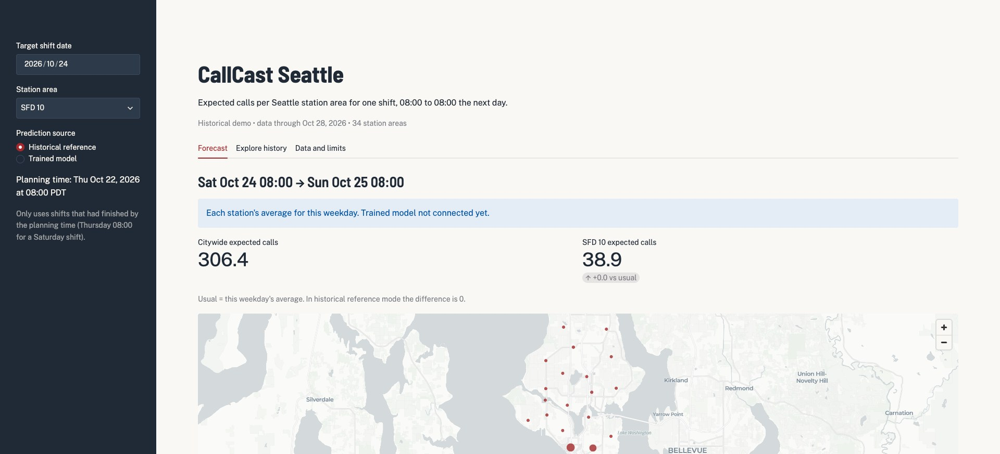
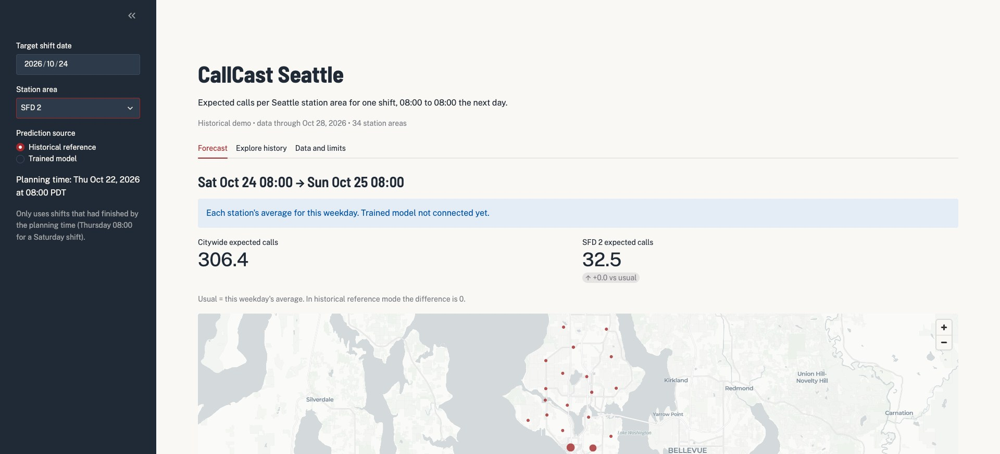
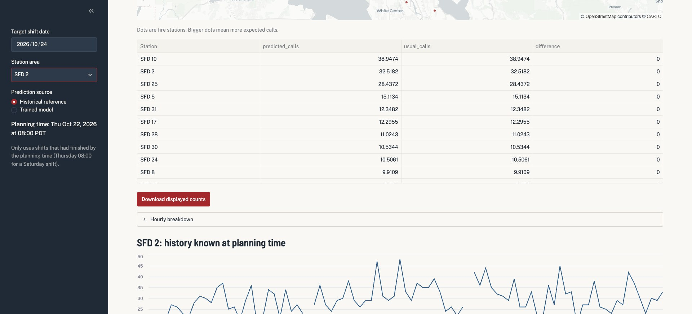
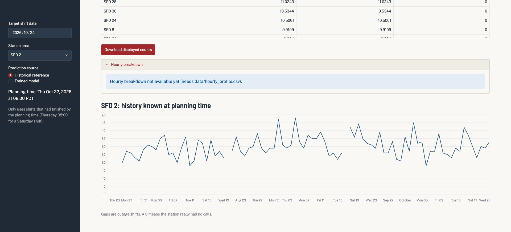
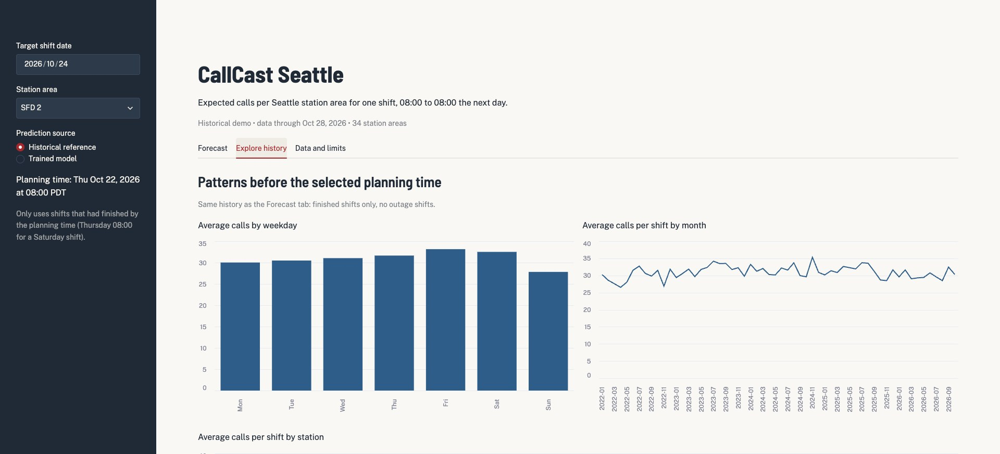
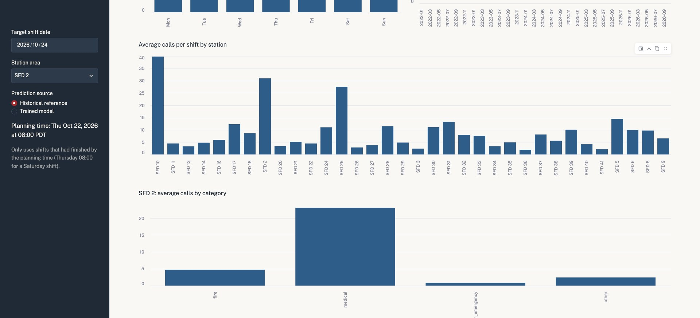
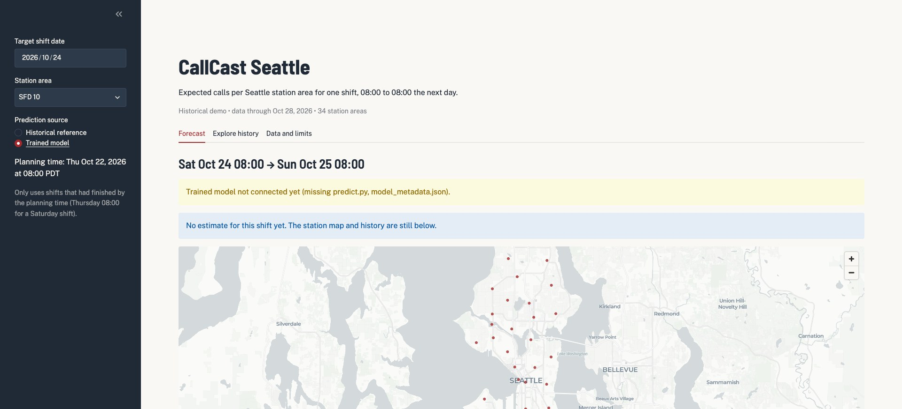
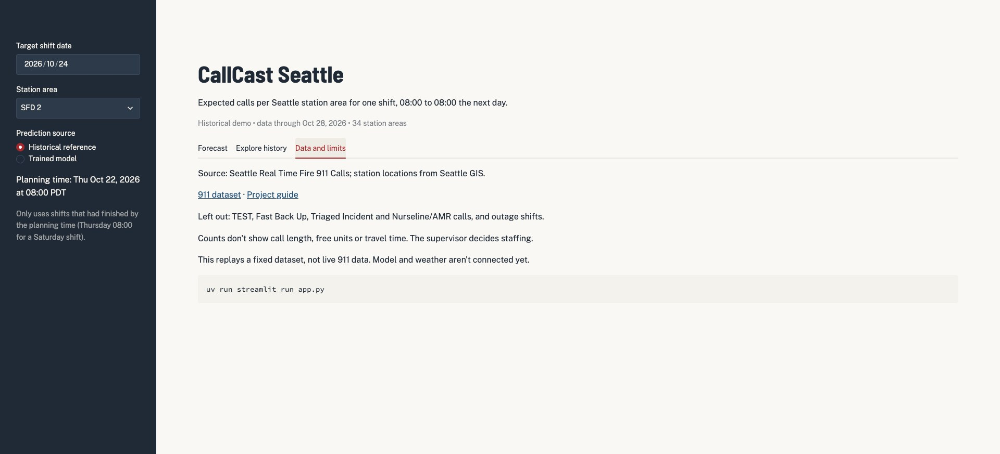

# CallCast Seattle app walkthrough

This goes through the app screen by screen and shows which CSV and which function each number comes from. Right now the app runs in "Historical reference" mode. "Trained model" mode works once the model is saved.

## 1. Start the app

```bash
uv run streamlit run app.py
```

Open the local address Streamlit prints (usually http://localhost:8501).



The code is in two files:

* [app.py](../app.py) draws the page.
* [app_data.py](../app_data.py) loads the data and does the calculations.

Streamlit reruns app.py from the top every time you change something in the sidebar. The CSVs are cached, so they're only read again when a file changes.

## 2. The three CSVs the app reads

| File | Variable | Used for |
|---|---|---|
| `sfd_stations.csv` | `stations` | station menu and map positions |
| `station_shift_counts.csv` | `counts` | historical average, "usual" comparison, all history charts |
| `modeling_dataset.csv` | `features` | input rows for the trained model |

The app doesn't read the raw 911 export or the type mapping. Those are only used upstream in the cleaning notebook.

When the app starts, `load_tables()` checks the CSVs: required columns, no duplicate station shifts, every station has every date, the four groups add up to `calls`, and the feature table matches the rows without an outage. If something is off, the app shows an error instead of wrong numbers.

## 3. Pick a date: the planning time

The default target is Saturday October 24, 2026, which means the shift from 08:00 Saturday to 08:00 Sunday.

`forecast_origin()` sets the planning time to two days earlier at 08:00:

| What | When |
|---|---|
| Supervisor plans | Thursday Oct 22, 08:00 |
| Latest finished shift | Wednesday Oct 21, 08:00 to Thursday 08:00 |
| Target shift | Saturday Oct 24, 08:00 |

So `known_history()` only keeps shifts up to October 21 and drops outage shifts:

```python
latest_complete = target_date - 3 days
history = counts.loc[(counts["ShiftDate"] <= latest_complete) & ~counts["Masked"]]
```

Thursday's and Friday's counts are in the CSV, but the app ignores them, because a supervisor wouldn't have them on Thursday morning.

## 4. The historical reference

With "Historical reference" and SFD 10 selected, `reference_predictions()` takes every earlier Saturday and averages `calls` for each station:

```python
same_day = history[history["ShiftDate"].dt.dayofweek == 5]  # 5 = Saturday
usual = same_day.groupby("Station")["calls"].mean()
```

For October 24:

| Station | Earlier Saturdays | Total calls | Average |
|---|---:|---:|---:|
| SFD 10 | 247 | 9,620 | 38.9 |
| SFD 2 | 247 | 8,032 | 32.5 |

The app shows 38.9 for SFD 10. A decimal is fine, since it's an expected count.

## 5. Change the station



Switching to SFD 2 changes the station number from 38.9 to 32.5, but the citywide total stays at 306.4. That's because the app always calculates all 34 stations, and the citywide number is their sum. The station menu only picks which one to show on the right.

"+0.0 vs usual" shows up because, in this mode, the estimate and the "usual" number are the same average. Once the trained model is connected, the two will differ.

## 6. Map, table and download

The map joins station coordinates from `sfd_stations.csv` to the estimates. Each dot is a fire station, and bigger dots mean more expected calls.



The table lists all 34 stations from most to fewest expected calls:

* `predicted_calls`: the estimate.
* `usual_calls`: the same weekday average.
* `difference`: predicted minus usual.

**Download displayed counts** saves this table as `callcast_counts.csv`, with the shift date, planning time and source added.

## 7. Hourly breakdown and history line



The count table only has totals per shift, so the hourly breakdown needs a separate file, `data/hourly_profile.csv`. It should have one row per station and hour (0 = 08:00), with shares that add up to 1. Until that file exists, the app says it isn't available yet.

The line chart shows the station's last 90 days of known history. A gap means an outage shift; a 0 means a real zero call shift. The line stops on October 21, the last finished shift.

## 8. Explore history



These charts use the same `history` as the Forecast tab. The weekday chart shows the station's average calls for each day, Monday to Sunday. The monthly chart shows the average per shift for each month, so longer months don't look busier just because they have more days.



Further down, the station chart compares every station, so it stays the same when you pick a different one. The category chart splits the selected station's calls into fire, medical, nonemergency and other.

The categories add up to `calls`, so they're fine for looking at past shifts but can't be model inputs.

## 9. Trained model mode



Choosing **Trained model** shows "Trained model not connected yet" until `predict.py` and `model_metadata.json` are in the project folder. When they are, `learned_predictions()` will:

1. Read the model name, its last training date and its input columns from `model_metadata.json`.
2. Refuse a model that was trained on shifts after the planning time.
3. Take the 34 rows for the target date from `modeling_dataset.csv`.
4. Pass only the model's input columns, never `calls` or the category counts.
5. Call `predict_shift()` from `predict.py` and check that the result has one valid number per station.

For example, SFD 2 on October 24 has `lag3` = 33 (its Wednesday count), `lag7` = 30, `avg7` = 32, `avg28` = 29.75 and `same_weekday_avg4` = 31.75.

## 10. Data and limits



This tab is just text:

* Station areas are approximate.
* Some call types are excluded.
* Counts don't show call length, available units or travel time.
* The data stops at a fixed snapshot.

## Try it yourself

1. Switch from SFD 10 to SFD 2. Why does the station number change but the citywide total doesn't?
2. Pick another date. What's the planning time, and what's the last shift the app can use?
3. Choose Trained model. Why do the numbers disappear while the map and history stay?
