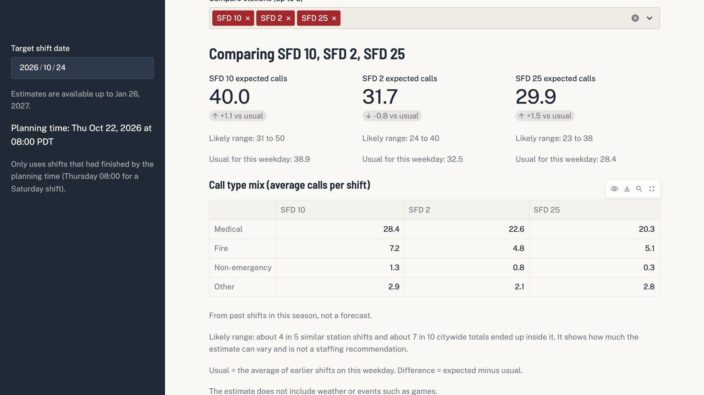
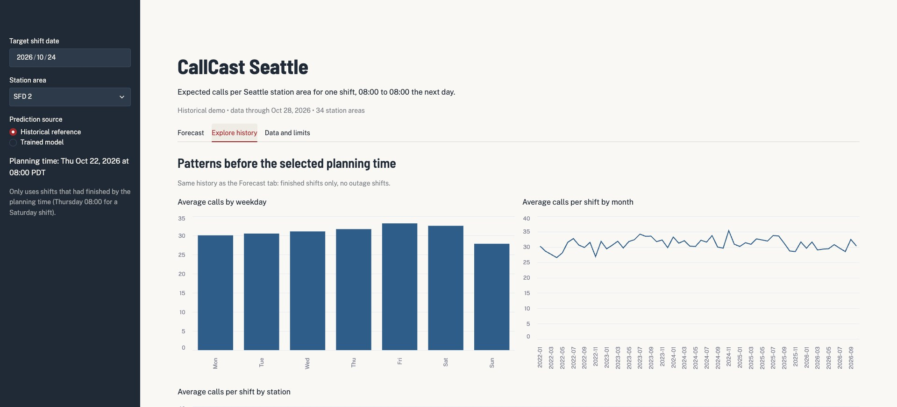
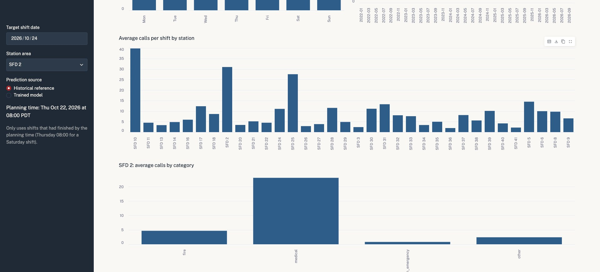

# CallCast Seattle app walkthrough

This goes through the app screen by screen and shows which CSV and which function each number comes from. The numbers come from Elisa's saved Poisson GBM, and each station's usual average for that weekday sits next to them for comparison. The app has three tabs: Prediction, Explore and Data and limits.

## 1. Start the app

```bash
uv run streamlit run app.py
```

Open the local address Streamlit prints (usually http://localhost:8501).


The code is in two files:

* [app.py](../app.py) draws the page.
* [app_data.py](../app_data.py) loads the data and does the calculations.

Streamlit reruns app.py from the top every time you change something in the sidebar. The CSVs are cached, so they're only read again when a file changes.

## 2. The CSVs the app reads

| File | Variable | Used for |
|---|---|---|
| `sfd_stations.csv` | `stations` | station menu and map positions |
| `station_shift_counts.csv` | `counts` | "usual" comparison, all history charts |
| `modeling_dataset.csv` | `features` | input rows for the trained model, up to October 28 |
| `forecast_features.csv` | `features` | the same input rows for the 3 forecast shifts, October 29 to 31 (no `calls` yet) |
| `prediction_ranges.csv` | `bands`, `city_range` | the likely range (Low and High) |
| `hourly_profile.csv` | read when you open the hourly breakdown | each hour's share of a shift |

The app doesn't read the raw 911 export or the type mapping. Those are only used upstream in the cleaning notebook.

When the app starts, `load_tables()` checks the CSVs: required columns, no duplicate station shifts, every station has every date, the four groups add up to `calls`, the feature table matches the rows without an outage, and the forecast file has 34 stations for each of the 3 dates after the last count. `load_ranges()` checks that the range bands have no gap. If something is off, the app shows an error instead of wrong numbers.

## 3. Pick a date: the planning time

The default target is Saturday October 24, 2026, which means the shift from 08:00 Saturday to 08:00 Sunday.

`forecast_origin()` sets the planning time to two days earlier at 08:00:

| What | When |
|---|---|
| Supervisor plans | Thursday Oct 22, 08:00 |
| Latest finished shift | Wednesday Oct 21, 08:00 to Thursday 08:00 |
| Target shift | Saturday Oct 24, 08:00 |

So `known_history()` only keeps shifts up to October 21 and drops outage shifts:

```python
latest_complete = target_date - 3 days
history = counts.loc[(counts["ShiftDate"] <= latest_complete) & ~counts["Masked"]]
```

Thursday's and Friday's counts are in the CSV, but the app ignores them, because a supervisor wouldn't have them on Thursday morning.

## 4. The usual number

For SFD 10, `reference_predictions()` takes every earlier Saturday and averages `calls` for each station. That average is the "Usual for this weekday" column:

```python
same_day = history[history["ShiftDate"].dt.dayofweek == 5]  # 5 = Saturday
usual = same_day.groupby("Station")["calls"].mean()
```

For October 24:

| Station | Earlier Saturdays | Total calls | Average |
|---|---:|---:|---:|
| SFD 10 | 247 | 9,620 | 38.9 |
| SFD 2 | 247 | 8,032 | 32.5 |

The app shows 38.9 as SFD 10's usual number next to the model's 39.3. A decimal is fine, since it's an expected count.

## 5. Change the station



Switching to SFD 2 changes the station number from 39.3 to 32.1, but the citywide total stays at 313.6. That's because the app always calculates all 34 stations, and the citywide number is their sum. The station menu only picks which one to show on the right.

"+0.3 vs usual" for SFD 10 and "-0.4 vs usual" for SFD 2 are the model's estimate minus the station's usual number from section 4.

## 6. Map, table and download

The map joins station coordinates from `sfd_stations.csv` to the estimates. Each dot is a fire station, and bigger dots mean more expected calls. Under the map are links to SFD Live (live incidents) and the Seattle Breaking guide (station coverage).


The table lists all 34 stations from most to fewest expected calls:

* "Expected calls": the estimate.
* "Low" and "High": the likely range around the estimate. About 4 in 5 similar past shifts landed inside it. It shows how much the estimate can vary and is not a staffing recommendation.
* "Usual for this weekday": the same weekday average.
* "Difference": expected minus usual.

**Download displayed counts** saves this table as `callcast_counts.csv`, rounded to one decimal like the screen, with the shift date and planning time added.

## 7. Hourly breakdown and history line


The count table only has totals per shift, so the hourly breakdown needs a separate file, `data/hourly_profile.csv`. Xiaoxue built it from 2022 to 2024: one row per station and hour (0 = 08:00), with shares that add up to 1. The app multiplies the shift total by each share. It skips the two daylight saving shifts a year, since those are 23 or 25 hours long: on October 31, 2026 (25 hours) the app says so instead of drawing.

The line chart shows the station's last 90 days of known history. A gap means a shift with missing data; a 0 means a real zero call shift. The line stops on October 21, the last finished shift.

## 8. Explore



These charts use the same `history` as the Prediction tab. The weekday chart shows the station's average calls for each day, Monday to Sunday. The monthly chart shows the average per shift for each month, so longer months don't look busier just because they have more days.



Further down, the station chart compares every station, so it stays the same when you pick a different one. The category chart splits the selected station's calls into fire, medical, nonemergency and other.

The categories add up to `calls`, so they're fine for looking at past shifts but can't be model inputs.

## 9. Where the expected calls come from

The numbers on the Prediction tab are Elisa's Poisson GBM. For October 24, SFD 10 gets 39.3 calls (+0.3 vs usual) and the city gets 313.6. Behind the scenes, `learned_predictions()`:

1. Reads the model's last training date (2025-12-31) and its input columns from `model_metadata.json`.
2. Refuses a model that was trained on shifts after the planning time. That's why the date picker starts at January 3, 2026, the first date the model can serve.
3. Takes the 34 rows for the target date from `modeling_dataset.csv`, or from `forecast_features.csv` for October 29 to 31.
4. Passes only the model's input columns, never `calls` or the category counts.
5. Calls `predict_shift()` from `predict.py` and checks that the result has one valid number per station.

For example, SFD 2 on October 24 has `lag3` = 33 (its Wednesday count), `lag7` = 30, `avg7` = 32, `avg28` = 29.75 and `same_weekday_avg4` = 31.75.

**Forecast dates.** October 29, 30 and 31 have no actual counts yet. The page marks them with a red "Forecast" tag, and the planning times are October 27, 28 and 29 at 08:00. The citywide totals are 317.7, 327.7 and 311.2.

**Likely range.** `add_likely_range()` adds Low and High to each estimate: the estimate plus the usual miss for a forecast of that size, from `prediction_ranges.csv`. For SFD 10 on October 24, 39.3 falls in the 20 to 40 band (-7.3 to +8.3), so the range is 32 to 48. The city is 313.6 with -30.0 to +32.5, so 284 to 346. `scripts/prediction_ranges.py` makes that file from the 2025 folds, and the README explains how.

## 10. Data and limits


This tab is just text, in four short sections:

* What the numbers mean: station areas are approximate, and what "usual" is.
* About the likely range: where it comes from and that it is not a staffing recommendation.
* What is left out: practice calls, duplicate records, two call types that stopped in May 2025 and shifts with missing data.
* What the numbers don't show: call length, available units or travel time. The data is a fixed snapshot.

It also has links to SFD Live and the Seattle Breaking coverage guide.

## Try it yourself

1. Switch from SFD 10 to SFD 2. Why does the station number change but the citywide total doesn't?
2. Pick another date. What's the planning time, and what's the last shift the app can use?
3. Open the date picker and go back as far as it allows. Why does it stop at January 2026?
