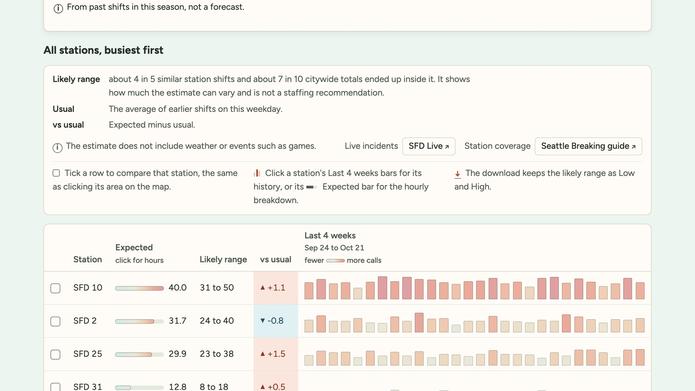
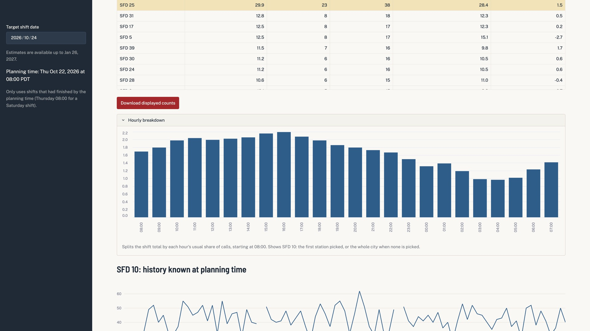
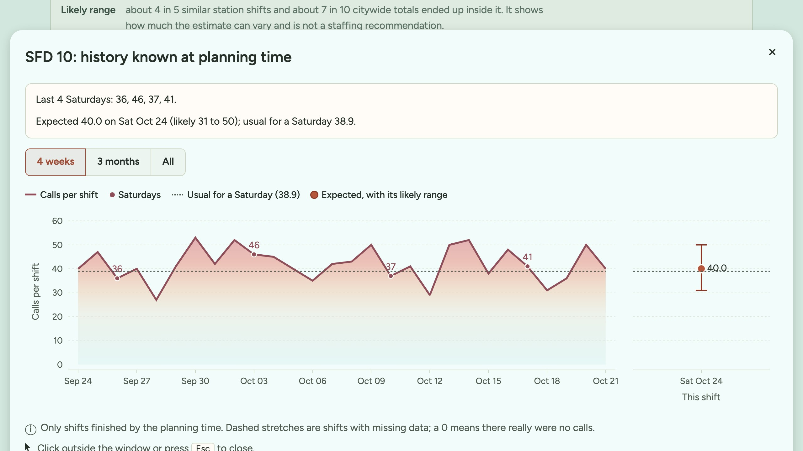
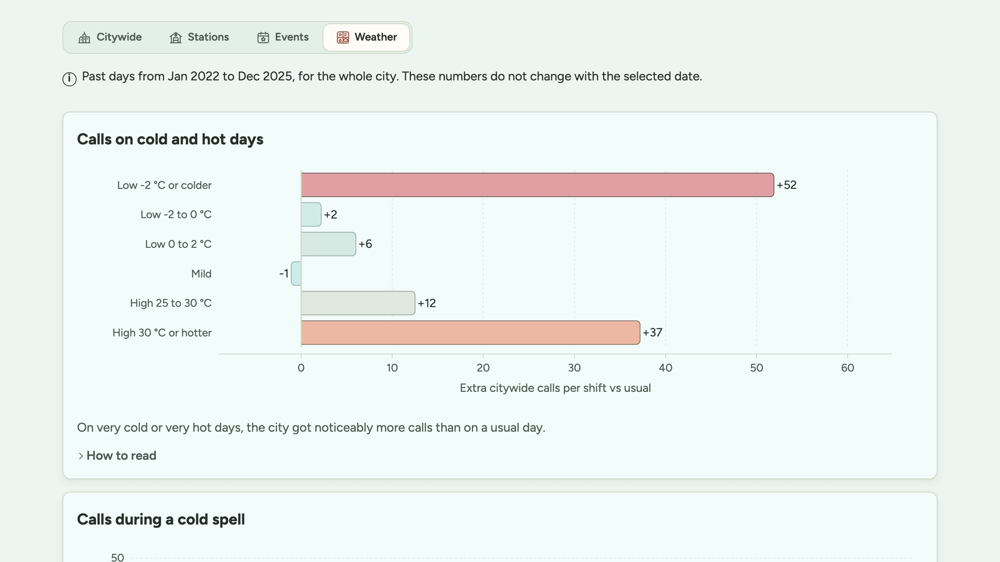
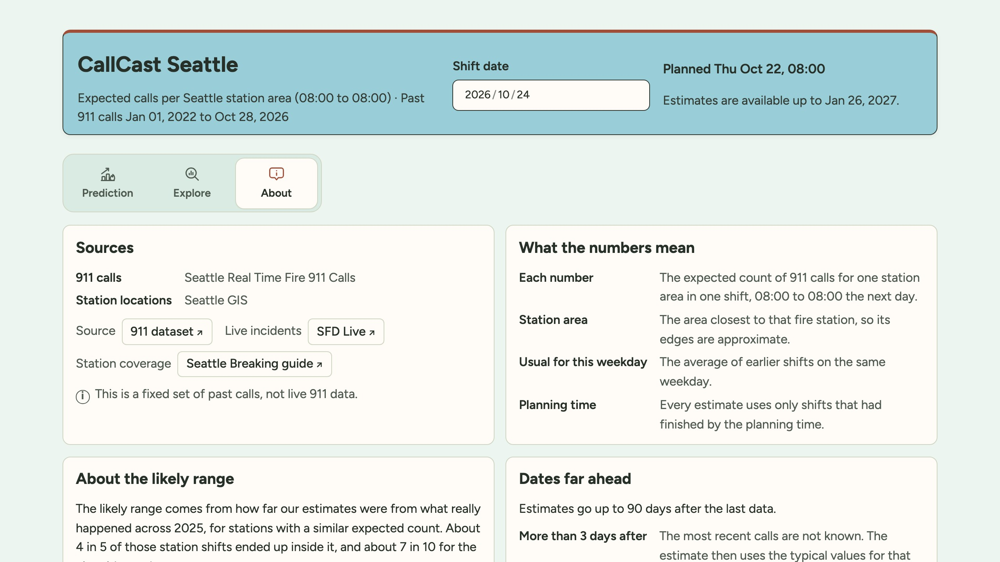
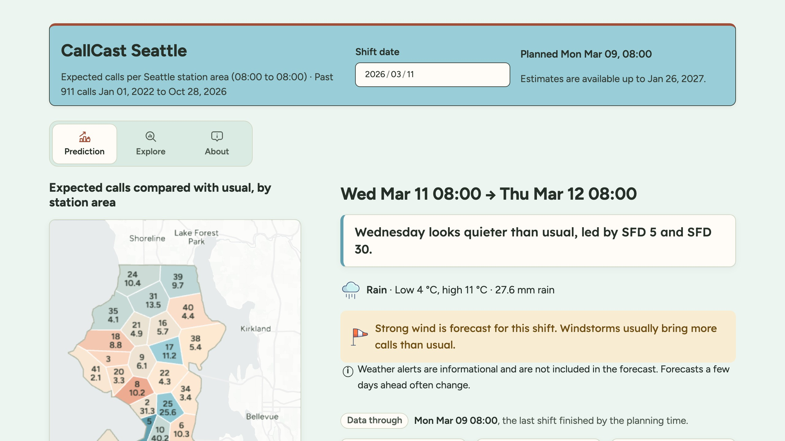

# CallCast Seattle app walkthrough

This walkthrough explains what a new team member sees in the app and, below
each screen, where every number comes from. It also describes the model,
the data, the calculations and the files behind the page.

The app is a supervisor-facing screen, not a staffing system. It predicts
911 call counts for one 08:00-to-08:00 shift. It does not know which units
are free, how long calls take or how far units must travel.

## 1. Start the app

From the repository root:

```bash
uv run streamlit run app.py
```

Open the local address printed by Streamlit. It is usually
`http://localhost:8501`.

The app has three tabs:

1. **Prediction** - choose a date, see the citywide estimate and the stations
   to watch, pick up to 3 stations on the map or in the ranked table to compare
   them, and download the table.
2. **Explore** - four sub-tabs of past patterns: **Citywide** (map, last 90
   days, weekday, month and call type), **Stations** (station-area map; click
   up to 3 areas to compare them), **Events** (how calls changed near the
   venues on past event days) and **Weather** (calls on cold and hot days,
   during cold spells and in past weather events).
3. **About** - read the source, definitions, left-out data and
   limitations.

The tabs sit in a rounded bar, each with a small outline icon above its name.
The open tab sits on a white tile that slides to the tab you click. Explore's
views use the same bar one size smaller, and its call type and share pickers
carry matching icons (`static/tab_icons/`, drawn as one set on a 24 px grid).
Buttons, tabs, table cells and the pop-up X lift 1 px under the mouse and
press in when clicked. Phones get the press only, and with reduced motion
turned on in the system settings nothing moves.

All text is in Figtree. The sentences that talk to the reader, such as the
briefing, the weather alerts and the event warnings, are in Lexend. Numbers
and the table always stay in Figtree.


The main code files are:

* [`app.py`](../app.py) builds the Streamlit page and chart elements.
* [`station_forecast.py`](../station_forecast.py) holds the Prediction tab's
  small calculations: the shift briefing, range-bar bounds, watch list, map
  shades, call type mix, the ranked table rows and download, click handling
  and "Data through" line.
* [`prediction_cards.py`](../prediction_cards.py) builds the HTML for the
  briefing callout, range bars and map legend.
* [`chart_theme.py`](../chart_theme.py) holds the colours, fonts and chart
  builders that the Prediction and Explore charts share. Every colour is one of
  six palette colours or a lighter or darker step of one. `style.css` gets them
  as CSS variables, and `.streamlit/config.toml` repeats them (a test checks
  they match).
* [`ui_sounds.py`](../ui_sounds.py) plays the soft UI sounds in
  `static/sounds/`: a hover tick and a click only on buttons, tabs, a
  clickable map area and the table cells that tick a station or open its
  window (the date box, the compare list and plain text stay silent), and the
  studio's click out when a window is closed by its X, Esc or a click
  outside. Nothing plays before the first click, because
  browsers block sound until then. With sound off or blocked the app works the
  same.
* [`app_data.py`](../app_data.py) reads CSVs, checks data, computes the usual
  calls and invokes the saved model.
* [`predict.py`](../predict.py) loads the saved GBM and transforms 34 feature
  rows into 34 predictions.
* [`model_metadata.json`](../model_metadata.json) describes the model cutoff
  and raw input columns.
* [`poisson_gbm.joblib`](../models/poisson_gbm.joblib) stores the fitted
  Poisson GBM.

Streamlit reruns `app.py` when the date changes or a station is picked. App
data is cached and is reread when the file modification times change. The
estimates, the usual calls and the call type mix for one date are cached too
(`forecast_for()`), so a map click does not rebuild them for all 34 stations.

## 2. The data loaded at startup

The app reads only the files needed for the page:

| File | App value | How the app uses it |
|---|---|---|
| [`sfd_stations.csv`](../data/sfd_stations.csv) | `stations` | station list for the compare box, station count and map coordinates |
| [`station_shift_counts.csv`](../data/station_shift_counts.csv) | `counts` | past calls, outage flags, weekday averages and Explore history |
| [`modeling_dataset.csv`](../data/modeling_dataset.csv) | `features` | model feature rows for historical 2026 dates |
| [`forecast_features.csv`](../data/forecast_features.csv) | appended to `features` | model feature rows for the 90 forecast shifts (Oct 29, 2026 to Jan 26, 2027), with no actual `calls` |
| [`prediction_ranges.csv`](../data/prediction_ranges.csv) | `bands`, `city_range` | point-estimate uncertainty for station and citywide numbers |
| [`hourly_profile.csv`](../data/hourly_profile.csv) | read inside the hourly expander | share of a station shift expected in each hour |

The app does not read the raw 911 export, call-type map or weather and event
experiment files.

Before displaying anything, `load_tables()` validates:

* required CSV columns,
* duplicate station/date rows,
* every station-date combination in the count table,
* whole-number and nonnegative call counts,
* fire + medical + non_emergency + other = `calls`,
* matching station identifiers,
* citywide outage flags, and
* forecast rows that cover 34 stations on every forecast date.

`load_ranges()` also verifies that station bands cover from zero without
gaps and that each range contains a low of zero or less and a high of zero
or more. If the shared files disagree, the app shows an error instead of
displaying a number that may be wrong.

## 3. How one shift is defined

The model and app use one 24-hour shift:

```text
08:00 on the target date -> 08:00 on the following date
```

October 24 is therefore the shift from Saturday October 24 at 08:00 through
Sunday October 25 at 08:00.

The supervisor does not plan in real time for that exact moment. The app
uses Thursday at 08:00 for a Saturday shift:

| Step | SFD 10 example |
|---|---|
| Target shift | Saturday October 24, 08:00 to Sunday October 25, 08:00 |
| Planning time | Thursday October 22, 08:00 |
| Latest complete shift | Wednesday October 21, 08:00 to Thursday 08:00 |
| Earliest discarded planning data | Thursday and Friday counts that did not exist at planning time |

`forecast_origin()` computes the planning time as two calendar days before
the target shift, localized to `America/Los_Angeles`.

`known_history()` keeps only counts for shifts that had finished at that
planning time:

```python
latest_complete = target_date - 3 days
history = counts.loc[
    (counts["ShiftDate"] <= latest_complete)
    & ~counts["Masked"]
]
```

The three-day subtraction is not an arbitrary safety rule. The model uses
features starting at `lag3`, and lags 1 and 2 would contain shifts not
finished at the Thursday morning planning time.

The date picker starts at January 3, 2026. It ends at the last row of
`forecast_features.csv`, 90 days after the last day of counts: currently
January 26, 2027. The top bar says so beside the picker: "Estimates are
available up to Jan 26, 2027." and opens on today's Seattle date clamped inside
that range (the examples below use October 24). If a later date reaches `learned_predictions()`,
it answers "No estimate for this date yet: estimates go up to Jan 26, 2027."

Thirteen historical shifts have missing model-input rows:
January 9; March 20; April 23; May 7; June 13; July 17, 19, 20, 22, 24 and
25; August 20; and September 17. For one of those dates, the briefing is the
only message. On Friday January 9, 2026 it says:

```text
Friday has no call estimate because the call data for this shift has a gap.
```

Beside it, the station-area map stays the same shape, with every area in one
pale sage shade and its station number only; pointing at an area says "No
estimate for this shift". Clicks still pick up to 3 stations for the next date.
One note points to the Explore tab for past calls, next to the two link chips.

## 4. The normal Saturday example



Leave the date at October 24 and pick SFD 10 (click its area on the map, tick
its row in the table, or choose it in the list under the map). The page
calculates:

| Card or column | Value | Meaning |
|---|---:|---|
| Citywide expected calls | 312.8 | Sum of 34 station point estimates |
| SFD 10 expected calls (after picking it) | 40.0 | Fitted GBM estimate for SFD 10 |
| SFD 10 Usual | 38.9 | Earlier Saturday average for SFD 10 |
| SFD 10 Difference | +1.1 | 40.0 minus 38.9 |
| Citywide Usual | 306.4 | Sum of all 34 station weekday averages |
| Citywide Difference | +6.3 | 312.8 minus 306.4 |

The card values use rounded display numbers. The citywide difference is
calculated from the full, unrounded station sums, even though it is shown
to one decimal.

## 5. How the usual number is calculated

`reference_predictions()` does not ask the GBM for a normal Saturday. It
uses real past counts.

```python
history = known_history(counts, target)
same_day = history[
    history["ShiftDate"].dt.dayofweek
    == target.dayofweek
]
usual = same_day.groupby("Station")["calls"].mean()
```

For October 24, the app selects earlier Saturdays through October 21.
Outage shifts have already been removed.

| Station | Earlier Saturdays | Sum of calls | Usual |
|---|---:|---:|---:|
| SFD 10 | 247 | 9,620 | 38.9 |
| SFD 2 | 247 | 8,032 | 32.5 |

The usual value is a decimal because it is an average, not a promised whole
number of calls.

The difference is:

```text
Difference = GBM estimate - usual weekday average
```

A positive difference means the model expects more calls than the historical
Saturday average. A negative difference means the model expects fewer.

## 6. How the point forecast is calculated

The production model is a **Poisson Gradient Boosting Machine**. It builds
many small correction trees one after another. It is a fitted mathematical
model, not a staffing tool, and it does not dispatch units.

The saved model file is:

```text
models/poisson_gbm.joblib
```

Its metadata is:

```text
model_metadata.json
```

The metadata identifies the last training shift, December 31, 2025, and
lists the raw inputs sent to the model.

For every target date, `learned_predictions()`:

1. Checks that `predict.py` and `model_metadata.json` exist.
2. Checks the model's training cutoff against the target planning time.
3. Selects exactly one feature row for each of the 34 stations.
4. Rejects the date if no feature rows exist.
5. Rejects missing station rows or duplicate station-date rows.
6. Sends only the metadata-listed input columns to `predict_shift()`.
7. Never sends `calls`, outage flags or call-category columns.
8. Checks that the output has 34 finite, nonnegative station estimates.

The model input has:

* station identity,
* weekday,
* month,
* `is_holiday`,
* `is_holiday_eve`,
* `lag3`,
* `lag7`,
* `avg7`,
* `avg28`,
* `same_weekday_avg4`.

`predict.py` converts station and weekday into one-hot indicator columns,
keeps the numeric features, and reorders every column to the exact saved
model column list.

For SFD 2 on October 24, the underlying feature values include:

| Feature | Value |
|---|---:|
| `lag3` | 33 |
| `lag7` | 30 |
| `avg7` | 32 |
| `avg28` | 29.75 |
| `same_weekday_avg4` | 31.75 |

These values mean:

* `lag3`: SFD 2 had 33 calls exactly 3 shifts before the target.
* `lag7`: SFD 2 had 30 calls 7 shifts back.
* `avg7`: average over the recent allowed seven-shift window.
* `avg28`: average over the recent allowed 28-shift window.
* `same_weekday_avg4`: average from the four earlier matching weekday shifts.

The saved model applies its learned tree structure to these values and
returns 34 numerical call estimates. It does not choose a random answer and
does not update from clicks in the app.

## 7. Pick stations to compare


The top bar has the shift date and the planning time (no side panel). Stations are picked in
the Prediction tab, in any of three places that stay in step:

* click a station area on the map (a second click on a picked area removes
  it),
* tick a station's row in the ranked table (untick it to remove it),
* or choose stations in the "Compare stations (up to 3)" list under the map,
  which works with a keyboard and on a phone.

The list is the one place the picks are kept. The map and the table only
report clicks: each click or tick picks or unpicks one station. Three stations
is the limit. A fourth click on the map or a fourth ticked row is refused with
a message ("Up to 3 stations can be compared at once ..."), the refused row is
unticked again, and the list stops at three. The message shows next to where
the click came from: above the map or above the table.

Nothing is picked at first. On a laptop the map is on the left and, to its
right, the shift heading, a plain briefing sentence (for October 24:
"Saturday looks a little busier than usual, spread across the city."), the
weather line ("Cloudy · Low 6 °C, high 14 °C" with a cloud icon), the weather
alert or "No weather alerts for this shift.", the "Data through" line, then
three bordered cards (citywide expected calls with its range bar, the station
with the biggest rise vs usual (SFD 39 on October 24) with its range bar, and
stations to watch). Below the map, across the full width, come the call type
mix, the ranked table and download. A station's history and its hourly
breakdown open in windows from the table (sections 12 and 13). On a phone everything stacks: briefing and cards first, then the map,
then the rest. Each range bar marks the likely range as a band, the
expected count as a circle and the usual weekday average as a vertical tick. With
stations picked it adds a "Comparing ..." block of bordered cards, one per
station: expected calls and difference from usual, a range bar showing the
likely range and usual weekday average, and any event warning for that station.
The station list is generated from `sfd_stations.csv` and ordered numerically.
The page does not rerun the model for only one station: `learned_predictions()`
calculates all 34 stations once per date.

Picking SFD 2 after SFD 10:

* adds a second card with SFD 2's 31.7 estimate next to SFD 10's 40.0,
* ticks both rows in the table and colours their station names lavender and yellow, each
  with its pick number (1, 2), like their rims on the map, their cards and their tags,
* leaves the citywide card at 312.8.

The citywide estimate is the sum:

```text
Citywide = station 2 estimate
         + station 3 estimate
         + ...
         + station 35 estimate
```

The app also adds selected station differences using the usual value:

```text
SFD 2 difference = 31.7 - 32.5 = -0.8
```

## 8. The map

The Prediction map (`forecast_map()` in `station_areas.py`) draws the real 34
nearest-station areas cut at the city boundary in a flat, north-up frame
(`pitch=0`, `bearing=0`) on a pale Carto basemap with nearby town names on
their real towns (Shoreline, Lake Forest Park, Kirkland, Bellevue, Mercer
Island, Renton, Tukwila, Burien), white borders between areas,
station numbers and expected calls written inside areas, and colour showing
expected minus usual (`difference_fills()` in `station_forecast.py`):

```text
difference = expected calls - usual for this weekday
```

Blue is quieter than usual, cream is about usual and salmon is busier. The
scale is the same size on both sides and never stretches a gap smaller than 2
calls to the full colour. Blue and salmon stay apart for people with red-green
colour blindness, the busier end is darker than the quieter end so the two
sides also differ in grayscale, and the legend under the map names both ends in
words. The Explore maps keep their own Carto basemap and sage shades for
history, so a historical average is never mistaken for a forecast. Pointing at
an area shows its status in words, expected calls, likely range and usual.
Picked areas get a coloured rim (1st lavender, 2nd warm yellow, 3rd mint) that
matches the top border on their comparison card below and the Explore comparison
charts. Each rim sits on a darker edge of its own hue, so it shows on light and
salmon areas alike. Labels on the pick colours are dark, and the cards, tags
and table rows also carry the pick number 1, 2 or 3. The map never moves: no
drag, zoom or zoom buttons (`FIXED_VIEW` and `MAP_LOCK_JS` in `station_areas.py`),
so the whole city always shows. `fixed_view()` works out the zoom from the city's
edges and the town names so they all fit a 360 px phone frame, with at least
40 px of land above and below the city, and the map's height from the same fit.
From 1160 px wide the map sits beside the cards and grows to fill the left
column, so it ends level with them; below that the map's column would be
narrower than the fit, so the cards come first and the map follows at full
width.

### Stations to watch

The third card names at most 5 stations that are likely busier than usual:
expected at least 2 calls and at least 10% above usual (`WATCH_MIN_EXTRA` and
`WATCH_MIN_SHARE`). A smaller gap is inside the normal swing from shift to
shift. A "How they are picked" toggle under the list gives the rule. When no
station passes, the card says "No station is clearly busier than usual for
this shift." (October 24). On New Year's Eve, December 31, 2026, it lists SFD
2, SFD 25, SFD 10 and SFD 5. A rule
based on the width of the likely range was tried first and found too strict:
the ranges are about 20 calls wide, so no station passed on any of the test
dates.

### Call type mix

For the picked stations (or the whole city when none is picked) the page shows
the average medical, fire, non-emergency and other calls per shift in the same
months of earlier years, using only shifts finished by the planning time and
without missing data. It is history, not a forecast: per-station forecasts by
call type are not in the app because there are too few calls.

### Data through

Above the cards, a "Data through" tag reads "Thu Oct 22 08:00, the last shift
finished by the planning time." (the Wednesday shift ends Thursday at 08:00).

Above the ranked table, one card defines Likely range, Usual and vs usual in
two columns, notes that the estimate does not include weather or events such
as games (leaving out any part a weather alert or event note above already
says), and has two link chips: SFD Live (live incidents) and the Seattle
Breaking guide (station coverage). Its last row shows how to use the table,
each hint led by a small picture of the control: tick a row, click the Last
4 weeks bars or the Expected bar, and what the download keeps.

## 9. The ranked table

The table sorts all 34 stations from highest to lowest point estimate. Tick a
row to pick that station (see section 7); picked rows are ticked and their
station name has the station's colour. Over Expected and Last 4 weeks the
pointer turns into a hand and the row is shaded: clicking Expected opens the
station's hourly breakdown (section 12) and clicking Last 4 weeks opens its
history (section 13). The click carries the row's own station name, so every
row opens its own station. The other cells open nothing. The on-screen
columns are:

| Column | Calculation |
|---|---|
| Station | station name |
| Expected | GBM prediction, one decimal, with a bar from 0 to the busiest station |
| Likely range | Low to High, for example "31 to 50" for SFD 10 on October 24 |
| vs usual | Expected minus usual: ▲ above usual in salmon, ▼ below in light blue (strong colour from 2 calls) |
| Last 4 weeks | 28 bars, one per shift, each one solid colour, oldest on the left: the 28 days up to the last shift finished at the planning time (Sep 24 to Oct 21 for October 24, planned Thursday October 22). Each bar's colour also follows its calls, on the same scale in every row: lighter mint for fewer calls, through cream and peach, to rose for more (a tiny legend under the heading shows it). All rows share one scale. Point at a bar for its date and count; the shift's weekday says so, for example "Sat Oct 17, same weekday: 41 calls" (SFD 10's Saturdays Sep 26, Oct 3, Oct 10 and Oct 17 had 36, 46, 37 and 41). The bars fill the column: about 20 px wide on a laptop, 5 px on a phone |

The Last 4 weeks bars follow the date. A day after the last day of data
(October 28, 2026) has no real calls, so its bar is the app's own estimate for
that shift, drawn a little lighter, and the heading says "estimated after Oct 28". For
November 27 the bars run from October 28 to November 24: only October 28 is
real and the other 27 days are estimates. A day with a data gap has no bar,
only a flat line.

The usual for this weekday is no longer a column: it is in vs usual, the
history window and the download.

The download keeps the earlier columns: Expected calls, Low, High, Usual for
this weekday and Difference (see section 11).

The Low and High values are not generated by the GBM. They come from past
prediction errors.

## 10. How the likely range is calculated

The range script is [`prediction_ranges.py`](../scripts/prediction_ranges.py).
It does not invent a confidence value from a formula inside the GBM.

For every station in each 2025 quarterly cross-validation fold:

1. Train on earlier real shifts.
2. Predict on the quarter's real validation shifts.
3. Calculate:

   ```text
   actual calls - predicted calls
   ```

4. Put the prediction in a station forecast-size band.
5. Use the 10th and 90th percentiles of those errors as Low and High offsets.

The station bands are:

| Predicted calls | Low offset | High offset |
|---:|---:|---:|
| 0–5 | -2.4 | +2.7 |
| 5–10 | -3.5 | +3.8 |
| 10–20 | -4.7 | +4.8 |
| 20–40 | -7.3 | +8.2 |
| Over 40 | -8.9 | +9.9 |

For a station estimate, `add_likely_range()`:

```text
low = estimate + low offset
high = estimate + high offset
```

It rounds to whole calls and prevents a negative low value.

For SFD 10:

```text
40.02 is in the over-40 band
low = 40.02 - 8.9 = 31.1 -> 31
high = 40.02 + 9.9 = 49.9 -> 50
```

For the citywide estimate:

```text
312.8 + (-29.6) = 283.2 -> 283
312.8 + 32.0 = 344.8 -> 345
```

The city range is stored as one citywide offset in
[`prediction_ranges.csv`](../data/prediction_ranges.csv):

```text
-29.6 to +32.0
```

Coverage on the 2025 shifts used to make the ranges was:

* stations: 79.7%
* citywide: 79.7%

A holdout check, using ranges made from folds 1–3 and tested on fold 4,
was:

* stations: 78.6%
* citywide: 71.7%

The 10th-to-90th percentile range means that about 80% of comparable past
station shifts landed inside it. The citywide holdout coverage was about
70%, not 80%.

This is an empirical error interval, not a guaranteed coverage claim or a
staffing recommendation.

## 11. Download the displayed table

**Download displayed counts** creates a CSV named:

```text
callcast_counts_2026-10-24.csv
```

The download includes:

* all 34 stations in the table, with Low and High as two columns instead of
  the on-screen "Likely range" (the Last 4 weeks bars are not in the file),
* point estimates rounded to one decimal,
* usual calls rounded to one decimal,
* Low and High,
* target shift date,
* planning timestamp.

The planning timestamp includes the Pacific time offset. The download is
for reviewing or sharing the values shown in the app. It does not add a new
model prediction.

## 12. Hourly breakdown



Click a station's Expected bar in the table. A window opens with that
station's hourly breakdown; it closes on a click outside it, Esc or the X.
**Citywide hourly breakdown** next to the download button opens the same
window for the whole city.

The app loads [`hourly_profile.csv`](../data/hourly_profile.csv). Each row
contains:

* station,
* `shift_hour` from 0 to 23,
* share of that station's shift calls,
* history cutoff.

Hour 0 is 08:00. Hour 23 is 07:00 the following day.

For every station and hour:

```text
hourly expected calls = shift point estimate x hourly share
```

The shares must add to 1. For example, if SFD 10 has a 30-call shift estimate
and one hourly share is 0.05:

```text
30 x 0.05 = 1.5 expected calls
```

The app does not predict hour-by-hour call patterns from the GBM. It divides
one GBM shift estimate using historical hourly proportions.

The profile was built from 2022–2024 station calls. It is only available for
normal 24-hour shifts.

On daylight-saving transition shifts:

* a spring shift can be 23 hours,
* a fall shift can be 25 hours,
* the usual 24-hour share table is not valid.

October 31, 2026 is a 25-hour shift, so the window shows a plain message
instead of the chart.

## 13. The history window



Click a station's Last 4 weeks bars in the table.
A window opens over the page with that station's history known at the
planning time. It closes on a click outside it, Esc or the X. Ticking rows
is unchanged: the window never picks or unpicks a station.

On October 24 for SFD 10:

```text
planning time: October 22 at 08:00
latest complete shift: October 21
Last 4 Saturdays: 36, 46, 37, 41.
Expected 40.0 on Sat Oct 24 (likely 31 to 50); usual for a Saturday 38.9.
```

The chart opens on the last 4 weeks; the buttons switch to 3 months or all.

* the line is calls per shift; a missing or masked shift (Aug 20 and Sep 17,
  2026 for SFD 10) is a faint dashed bridge between its neighbours, with no dot,
  and pointing at it says "No data for this shift (data feed gap)" (a 0 is a
  real zero-call shift),
* dots mark the same weekday as the target; on 4 weeks they carry their counts,
* the dotted line is the usual for that weekday,
* the right panel shows the target shift: the expected calls and the likely
  range as a whisker, in the busier or quieter colour of the station's card,
* "All" fades the daily line and adds a 4-week average.

The right panel has its own axis, so a date far past the data (December 20)
does not squash the line. Then a third line says how old the newest known
shift is ("The newest known shift is Wed Oct 28, 53 days earlier.").

The window is historical context. It does not feed the GBM's point
prediction and it does not change the citywide total. On a date with a data
gap there is no table, so past calls are on the Explore tab.

## 14. Explore tab

The Explore tab uses the same `known_history()` result as the Prediction tab.
It does not include future shifts, future counts or masked outage shifts. A
note at the top says which shifts it uses. For a date more than 3 days past
the last counts, the note becomes a blue info box: every later date shows the
same history until new calls are added.

Explore has four sub-tabs. Every chart has a one-line caption on how to read
it.

### Citywide

* "Show calls for" picks All calls, Medical, Fire, Non-emergency or Other. The
  choice drives the map and the charts below it.
* A map shades each station area by its average calls per shift.
* A one-row table gives the citywide last week, last month, all history and
  busiest weekday.
* The last-90-days chart is a 7-shift average. For All calls it is stacked by
  call type.
* Weekday and monthly charts are averages per shift, so a longer month is not
  larger by size alone.
* The category chart shows how the city's calls split by type.

### Stations

* The station-area map shows the part of Seattle closest to each station,
  inside the city boundary (`station_areas.py`). Areas are shaded by fire,
  medical or other share, and hovering shows last week and last month.
* Clicking up to 3 areas compares them with the average station (citywide
  calls divided by 34): summary table, last 90 days, monthly, weekday and
  category share charts (`station_compare.py`).
* A bar chart shows every station's average in number order.

### Events

A venue map and tables of how calls changed near Lumen Field, T-Mobile Park,
Climate Pledge Arena and Husky Stadium on past event days (`event_explore.py`,
from `data/event_effects.csv` and `data/event_shifts.csv`, made by
`scripts/make_event_effects.py`). The numbers use 2022 to 2025 and do not
change with the selected date. The call types are for browsing past incident
mix only. The model uses total calls, not separate category targets.

### Weather

Three charts of how citywide calls changed with the weather
(`weather_explore.py`, from `data/weather_effects.csv`,
`data/weather_events.csv` and `data/weather_event_shifts.csv`, made by
`scripts/make_weather_effects.py`). Each compares calls with a usual day: the
same weekday up to 4 weeks before and after, without extreme-weather days and
holidays. The numbers use 2022 to 2025 and do not change with the selected
date. The charts share the look of the other Explore charts (`chart_theme.py`),
with muted blue for cold groups, sage for mild and brick for hot.

* Calls on cold and hot days: one bar per temperature group, from the
  coldest lows to the hottest highs. Holidays are left out.
* Calls during a cold spell: a single cold day, then day 1, 2, 3 and 4 or
  later of a spell (2 or more days in a row below freezing).
* Past weather events: pick one of four events (December 2022 cold, snow
  and ice; January 2024 cold snap; July 2022 heat wave; November 2024
  windstorm). The line shows each day's citywide calls from a week before to
  a week after, the dashed line the usual level, and the shaded days the
  event. The dates were checked in the weather data.



## 15. About tab



The About tab is text only, in six cards set two to a row. Each card puts a
bold label beside its plain answer, with a short muted note where needed:

* The Sources card names the 911 calls (Seattle Real Time Fire 911 Calls) and station
  locations (Seattle GIS), link chips to the 911 dataset, SFD Live and the
  Seattle Breaking guide, and a note that this is a fixed set of past calls,
  not live 911 data.
* What the numbers mean explains each number, station area (the area closest to
  that station, so its edges are approximate), usual for this weekday and
  planning time.
* About the likely range says about 4 in 5 station shifts and about 7 in 10
  citywide totals landed inside it in 2025, and it does not say how many units
  to send.
* Dates far ahead says estimates go up to 90 days after the last data, and
  more than 3 days after it they are long-range estimates.
* What is left out lists practice calls (TEST), duplicate follow-up records
  (Fast Back Up), two referral types that stopped being recorded after May
  2025, and data gaps.
* What the numbers don't show: how long a call takes, which units are free
  or travel time. Staffing is the supervisor's decision.

## 16. Forecast dates

The first three future dates are October 29, 30 and 31.

They come from `forecast_features.csv`, not from adding a new call to the
past count table.

| Date | Planning time | Citywide estimate |
|---|---|---:|
| October 29 | October 27 at 08:00 | 317.5 |
| October 30 | October 28 at 08:00 | 329.5 |
| October 31 | October 29 at 08:00 | 311.6 |

Each future date is marked **Forecast** because `station_shift_counts.csv`
has no actual counts after October 28.

October 31 has no hourly chart because it is a 25-hour shift.

From November 1 to January 26, 2027, the recent calls are not known.
`scripts/step4_features.py` already wrote these rows into
`forecast_features.csv`: the calendar and holiday inputs come from the date,
and each of the five lag inputs is its own average over past shifts with the
same station, weekday and month (saved in `data/lag_fill_means.csv`). The
heading adds "· long-range estimate" and one caption explains it. In a
backtest this beat the plain weekday average up to about 180 days ahead
(90-day citywide MAE 19.95 against 20.69), so the app stops at 90 days. The
likely range was measured on forecasts with real recent calls, so on these
dates it probably holds less often.

## 16b. Event warnings

For SFD 10 and SFD 22, the Prediction tab shows a gold warning in that
station's card, once the station is picked, when a big event falls on the
shift (`event_warnings.py`, from
`data/events.csv` and `data/concerts.csv`):

* Seahawks home game at Lumen Field: SFD 10,
* stadium concert at Lumen Field: SFD 10,
* Husky football home game at Husky Stadium: SFD 22.

The warning does not change the estimate or the range. One note under the
cards says "Event warnings are informational and are not included in the
forecast.", even when more than one card has a warning. The card above the
ranked table then only says "The estimate does not include weather.", so the
event part is said once.

## 16c. Weather alerts

Weather is one forecast for the whole city, so the alert sits right under the
shift briefing, above the summary cards (on a phone it stays under the
briefing too). When the forecast for the shift has strong wind (gusts of
65 km/h or more) or hard cold (a low of -3 °C or colder, or -1 °C or colder on
2 or more days in a row), it shows a gold warning, the same kind as the
event warnings in the station cards. The thresholds come from Step 15 in the
README. The text is plain, with no percentages, for example "Strong wind is
forecast for this shift. Windstorms usually bring more calls than usual." on
March 11, 2026. Each alert line has its own icon at the left: a windsock for
strong wind, a snowflake for a hard freeze and a thermometer for a cold spell.
A note under it says "Weather alerts are informational and are not included
in the forecast. Forecasts a few days ahead often change."



Between the briefing and the alert, a small weather line shows one icon for
the shift (thunder, snow, sleet, heavy rain, rain, fog, strong wind, cloudy,
partly cloudy or sunny: the most notable one in any hour of the shift), its
low and high, and the rain (mm) or snow (cm) when above zero
(`weather_now.py`). It uses the same forecast as the alert, so a date without
a forecast has no line, and it never changes the estimate. The weather icons,
the alert icons and the NWS logo are local files in `static/weather_icons/`
that are not in git; without them the line and the alerts show their words
only.

`weather_alerts.py` picks the forecast that was known at the planning time:

* dates with a saved forecast (to October 29, 2026) use the day-3 forecast in
  `data/weather_hourly_gfs_global_day3.csv`;
* later dates whose planning time has passed download that same day-3
  forecast from Open-Meteo's archive;
* dates still ahead use the latest Open-Meteo forecast (`gfs_seamless`), but
  only when the shift ends within 4 days.

A download waits at most 3 seconds to connect and 5 to read, a good answer is
kept for an hour, and after a failed one the app shows "unavailable" for 5
minutes before trying again, so clicks on the map stay quick without a
network (or in Docker without internet).

Without an alert, a caption says "No weather alerts for this shift.", "No
weather forecast available yet. Weather alerts appear about 4 days before the
shift." or, if the forecast cannot be read, "Weather forecast unavailable right
now." Like event warnings, weather alerts never change the estimate or the
range.

For every shift that is not over yet and ends within 4 days, one more caption
points to the official watches and warnings, with or without an alert: "For
snow, ice and the latest official watches and warnings, check the National
Weather Service: NWS Seattle." with the NWS logo in front of it (for example
November 28, 2026, picked on November 27). It is only a link to
https://www.weather.gov/sew/; the app does not call the NWS API.

## 17. What the app does not do

The app does not:

* train or retrain inside Streamlit,
* use SMOTE or synthetic training rows,
* send call categories to the GBM,
* use weather or event data in the saved model,
* show staffing recommendations,
* show actual unit availability,
* treat Low and High as guaranteed limits,
* predict each hour directly,
* use 2026 data to select or tune the model,
* update as new calls arrive after the user selects a date.

The app is a fitted-model replay and future-prediction interface. Training
and model comparison happen offline through scripts.

## 18. How training and app runtime differ

Offline model creation:

```bash
uv run python scripts/train_model.py
uv run python scripts/prediction_ranges.py
```

`train_model.py` trains on usable rows in `modeling_dataset.csv` through
2025 and rewrites `poisson_gbm.joblib` and `model_metadata.json`.

`prediction_ranges.py` creates Low and High offsets by running temporary
Poisson GBMs on 2025 rolling validation folds. It rewrites
`prediction_ranges.csv`.

App runtime:

```bash
uv run streamlit run app.py
```

The app loads saved artifacts, repeats the required preprocessing and makes
predictions. It does not run `.fit()` or retrain on the supervisor's clicks.

## 19. Try it yourself

1. Start at October 24 and pick SFD 10 on the map. Confirm 312.8 citywide and 40.0 for SFD 10.
2. Pick SFD 2 too. Confirm that the citywide number stays 312.8 and a second card shows 31.7. Pick two more stations: the fourth is refused with a message.
3. Open the table and verify that the highest estimate appears first. Tick SFD 25's row: it is
   picked like a map click. Tick a fourth row: it is refused and unticked.
4. Pick October 29. Confirm it is labelled Forecast and has a planning time of October 27 at 08:00.
5. Pick October 31 and click SFD 10's Expected bar. Confirm the hourly note instead of 24 hourly bars.
6. Pick October 25 and SFD 10. Confirm the Seahawks warning; remove SFD 10, pick SFD 5 and confirm it is gone.
7. Pick March 11. Confirm the strong-wind alert with its windsock icon under the briefing (with internet, November 7 shows one too).
   Pick a date in the next 4 days (November 28, 2026 on November 27): the NWS Seattle note shows with the NWS logo.
   Pick December 31 for a filled Stations to watch card, and January 9, 2026 for the data-gap briefing.
8. Open Explore. On Citywide pick Medical, on Stations click two areas to compare them, then open Events and Weather.
9. Open About and locate each source and limitation.
10. Download a table and compare its values with the on-screen table.
11. With sound on, click once anywhere, then point at a tab, a map area and a table cell: each
    gives one soft tick. The date box and the compare list stay silent. Click Last 4 weeks and
    close the window with Esc: one click, then one click out.
